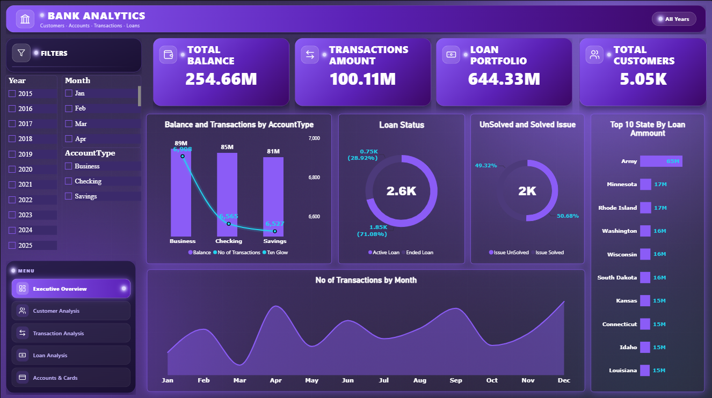
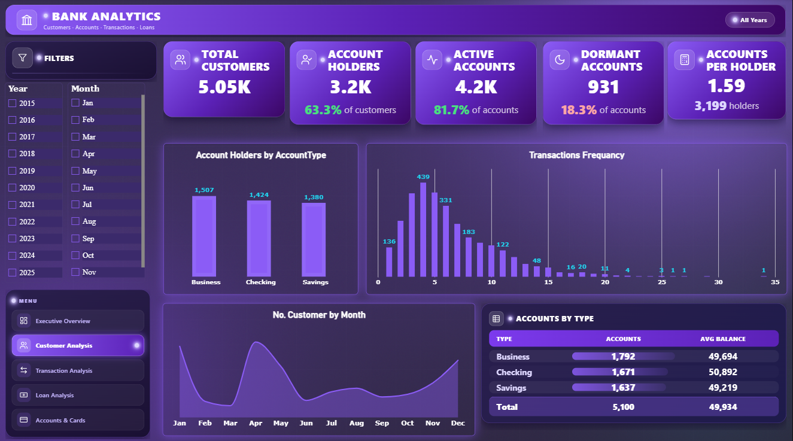
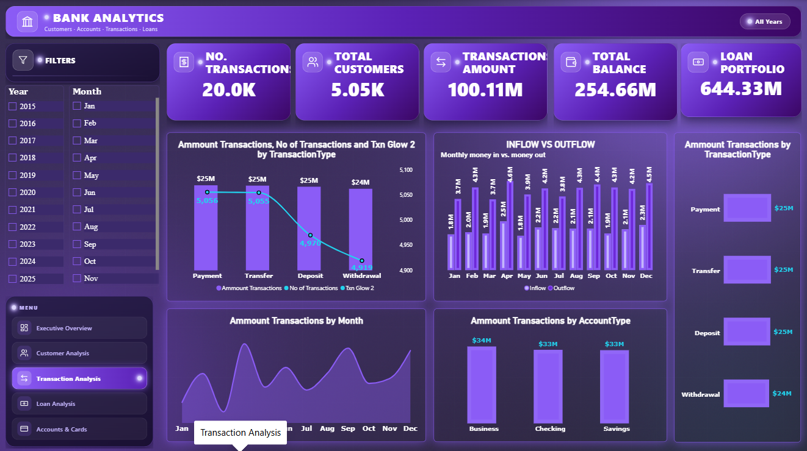
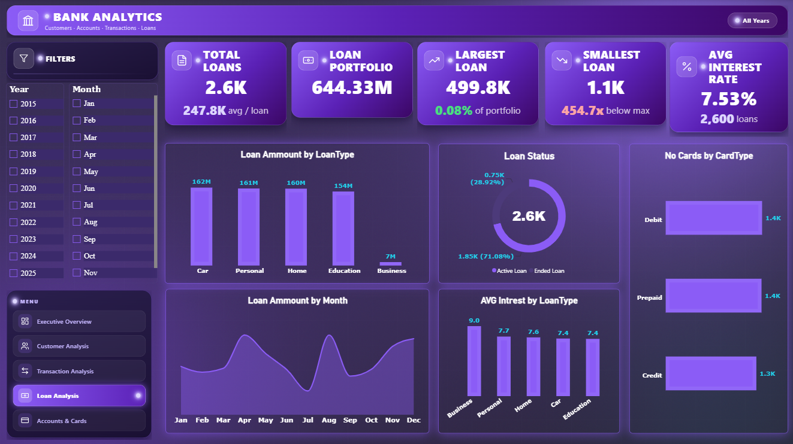
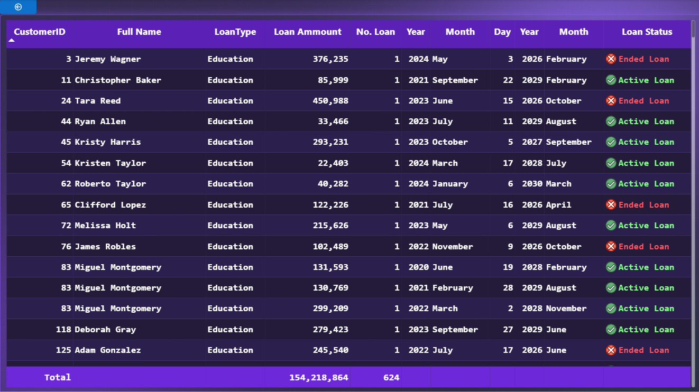
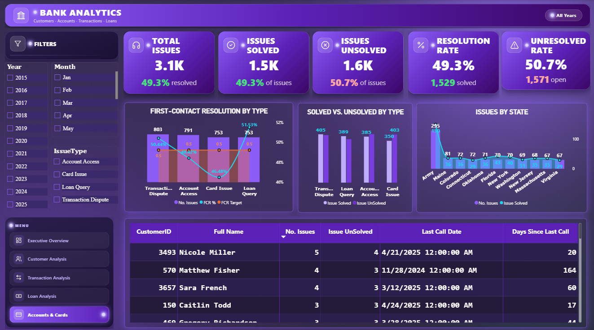

# 🏦 Banking Analytics Dashboard | Power BI

An interactive banking analytics solution built with **Microsoft Power BI** to transform banking data into meaningful insights and support data-driven decision-making.

This project was developed as **Sprint 2 of my Data Analysis Training**, focusing on customer behavior, account performance, transaction activities, loan portfolio analysis, and customer support operations.

The goal was not just to visualize data, but to understand banking performance, identify potential risks, and highlight opportunities for operational improvement.

---

## 📌 Project Overview

The Banking Analytics Dashboard consolidates data from six related tables into an interactive reporting solution.

The dashboard enables users to explore key banking metrics, compare performance across different categories, analyze monthly trends, and investigate customer and operational activities through interactive filters.

### 🎯 Business Objectives

- Monitor overall banking performance through executive KPIs.
- Understand customer activity and account utilization.
- Analyze transaction volumes, values, and behavioral patterns.
- Evaluate loan portfolio distribution, status, and interest rates.
- Monitor customer support issues and resolution performance.
- Identify potential operational risks and opportunities for improvement.

---

## 📊 Dashboard Pages

### 1. Executive Overview

Provides a high-level summary of banking performance and key operational indicators.



**Key Metrics & Analysis**
- Total Account Balance
- Total Transaction Amount
- Total Loan Portfolio
- Total Customers
- Balance and Transactions by Account Type
- Loan Status Distribution
- Support Issue Resolution Status
- Transaction Trends by Month
- Loan Amount by State

**Business Purpose:** Give management a consolidated view of banking activity and help identify areas that require further investigation.

### 2. Customer Analysis

Explores customer distribution, account ownership, account utilization, and transaction frequency.



**Key Metrics & Analysis**
- Total Customers
- Account Holders
- Active Accounts
- Dormant Accounts
- Accounts per Holder
- Account Holders by Account Type
- Transaction Frequency
- Monthly Customer Trends
- Accounts and Average Balance by Type

**Business Purpose:** Understand customer engagement, identify dormant accounts, and explore opportunities to improve account utilization and customer retention.

### 3. Transaction Analysis

Examines transaction activity, transaction values, and money movement across different transaction and account types.



**Key Metrics & Analysis**
- Number of Transactions
- Total Transaction Amount
- Transaction Amount by Type
- Transaction Volume by Type
- Monthly Transaction Trends
- Inflow vs. Outflow
- Transaction Amount by Account Type

**Business Purpose:** Understand transaction behavior, monitor activity trends, and identify unusual patterns that may require further review.

### 4. Loan Analysis

Analyzes loan portfolio size, loan distribution, loan status, and interest rate differences across loan categories.



**Key Metrics & Analysis**
- Total Loans
- Total Loan Portfolio
- Largest and Smallest Loan
- Average Interest Rate
- Loan Amount by Loan Type
- Active vs. Ended Loans
- Monthly Loan Amount Trends
- Average Interest Rate by Loan Type
- Card Type Distribution

**Business Purpose:** Understand portfolio composition, compare lending categories, and monitor loan status and interest rate patterns.

### 5. Loan Details

Provides a detailed, row-level view of loan records to support investigation and validation of portfolio information.



**Key Information**
- Customer ID and Full Name
- Loan Type and Loan Amount
- Loan Record Count
- Loan Start Date Components
- Loan End Date Components
- Loan Status

**Business Purpose:** Allow users to drill down from aggregated loan metrics to individual records and investigate loan details.

### 6. Customer Support Analysis

Evaluates customer support workload, resolution performance, issue categories, and unresolved cases.



**Key Metrics & Analysis**
- Total Support Issues
- Issues Solved and Unsolved
- Resolution Rate
- Unresolved Rate
- First-Contact Resolution by Issue Type
- Solved vs. Unsolved Issues by Type
- Issues by State
- Customers with Repeated Issues
- Days Since Last Call

**Business Purpose:** Identify common customer problems, monitor service performance, and highlight opportunities to improve issue resolution and customer experience.

---

## 📈 Key Metrics at a Glance

The following figures are taken from the dashboard screenshots and represent the values displayed in the current report.

| Metric | Displayed Value |
|---|---:|
| Total Customers | 5.05K |
| Total Account Balance | 254.66M |
| Total Transaction Amount | 100.11M |
| Total Loan Portfolio | 644.33M |
| Number of Transactions | 20.0K |
| Total Loans | 2.6K |
| Average Interest Rate | 7.53% |
| Active Accounts | 4.2K |
| Dormant Accounts | 931 |
| Total Support Issues | 3.1K |
| Support Resolution Rate | 49.3% |
| Unresolved Issues | 1.6K |

*Note: Values are displayed using the report's current formatting and filters. Detailed definitions, aggregation rules, and validation should be considered when interpreting these metrics.*

---

## 💡 Business Insights & Recommendations

The dashboard highlights several areas worth investigating further.

### 1. Customer Engagement & Dormant Accounts

The report displays 931 dormant accounts, representing 18.3% of accounts.

**Recommendation:** Investigate the characteristics and inactivity patterns of dormant accounts. Develop targeted re-engagement campaigns and monitor whether account activity improves.

### 2. Transaction Monitoring

Transaction values and volumes vary across transaction types and account categories.

**Recommendation:** Establish appropriate transaction monitoring thresholds and investigate unusual patterns using customer history, transaction frequency, amount, and other available risk indicators. Large transactions alone should not be treated as proof of fraud.

### 3. Loan Portfolio Monitoring

The dashboard provides visibility into loan amounts, loan types, status, and interest rates.

**Recommendation:** Monitor portfolio concentration by loan type and geography, review upcoming maturities where reliable maturity dates are available, and investigate overdue or default indicators if supported by the data.

### 4. Customer Support Performance

The displayed resolution rate is 49.3%, while 50.7% of issues are unresolved.

**Recommendation:** Investigate the main drivers of unresolved issues, prioritize recurring customer problems, and monitor resolution rates by issue category and time period.

### 5. Data Quality & KPI Validation

Banking analytics depends on accurate relationships, consistent business definitions, and appropriate aggregation across customers, accounts, transactions, and loans.

**Recommendation:** Validate KPI calculations against source records and review relationship behavior before using dashboard metrics for operational or financial decisions.

*These are preliminary, data-informed recommendations based on the current dashboard. Further investigation is required before drawing causal conclusions or implementing business changes.*

---

## 🧩 Challenges & Learning Outcomes

### Challenges Faced

- **Data Modeling:** Working with multiple related banking tables while maintaining correct relationships and table granularity.
- **DAX & Business Logic:** Defining meaningful measures and ensuring that calculations reflect the intended business definitions.
- **Data Aggregation:** Avoiding misleading totals when combining data from tables with different levels of detail.
- **Dashboard Design:** Organizing multiple KPIs and visuals into a consistent, interactive reporting experience.
- **Business Interpretation:** Moving beyond descriptive charts to identify operational questions and actionable opportunities.

### Key Learnings

- Building and validating relationships in a relational data model.
- Developing DAX measures for banking KPIs.
- Using filters and interactive visuals to explore business performance.
- Translating operational metrics into business questions.
- Communicating findings and recommendations through data storytelling.

---

## 🛠️ Tools & Technologies

- **Microsoft Power BI** — Dashboard development and interactive reporting.
- **Power Query** — Data preparation and transformation.
- **DAX** — Measures, KPIs, and analytical calculations.
- **Data Modeling** — Relationships and analytical model design.
- **Data Visualization** — KPI cards, charts, tables, and interactive filters.
- **Business Intelligence** — Banking performance analysis and decision support.

---

## 📁 Repository Structure

```text
Banking-Analytics-Dashboard/
│
├── screenshots/
│   ├── 01_Executive_Overview.png
│   ├── 02_Customer_Analysis.png
│   ├── 03_Transaction_Analysis.png
│   ├── 04_Loan_Analysis.png
│   ├── 05_Loan_Details.png
│   └── 06_Customer_Support_Analysis.png
│
├── Banking_Analytics.pbix
└── README.md
```

---

## 🚀 How to Explore the Project

1. Clone or download this repository.
2. Open `Banking_Analytics.pbix` using Microsoft Power BI Desktop.
3. Explore the report pages using the navigation menu.
4. Use the available year, month, account type, and issue type filters to investigate different segments.
5. Compare KPIs, trends, and categories to explore banking performance.

---

## 🙏 Acknowledgment

Special thanks to **Jana Hatem** for the guidance throughout the training, and to **Mohamed Megahed** and **Mohamed Ibrahim** for their feedback and support.

This project is part of my ongoing journey in Data Analytics and Business Intelligence, applying analytical thinking to real-world business scenarios.

---

## 💬 Feedback & Contributions

I'm continuously learning and improving my analytical and technical skills.

I'd appreciate your feedback, suggestions, and ideas on how to improve the data model, analytical measures, dashboard design, and business insights.

**Thanks for checking out my project!** ⭐

#PowerBI #DataAnalytics #BankingAnalytics #BusinessIntelligence #DAX #DataModeling #DataVisualization #DataStorytelling
